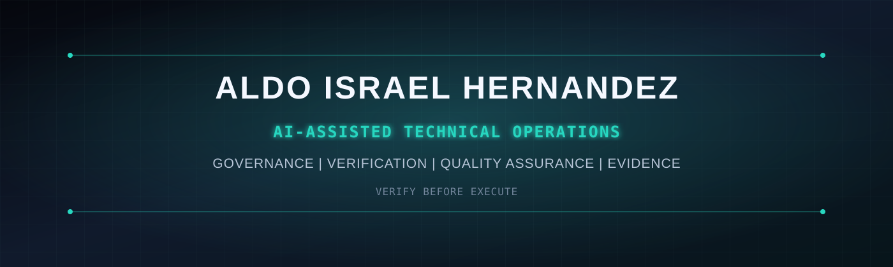

  

<h1 align="center">Aldo Israel Hernandez</h1>

  <strong>Independent Security Research | AI Governance | Adversarial Testing | Pre-Execution Security</strong>

  Building disciplined, evidence-backed workflows for frontier AI systems.

  <a href="mailto:israelhernandezpin@gmail.com">Email</a> |
  <a href="https://github.com/VerifywithAION">Verify with AION</a> |
  <a href="#selected-work">Selected Work</a> |
  <a href="#open-to-work">Open to Work</a>

---

## Professional Profile

I am an AI engineering student and independent technical project operator focused on using frontier AI systems to convert written requirements into structured, tested, and documented outputs.

My work emphasizes:

- Following detailed written specifications and acceptance criteria
- AI-assisted repository implementation
- Output verification and quality assurance
- Evidence collection and reproducibility
- Repository organization and technical documentation
- Pre-execution governance and safety controls
- Iterative correction when results fail validation
- Clear separation between proposed, authorized, and executed actions

I am currently enrolled in a **52-Week AI Engineering Bootcamp** while developing practical projects through the [Verify with AION](https://github.com/VerifywithAION) organization.

> This portfolio represents AI-assisted technical execution and project coordination. My contribution includes requirements definition, implementation coordination, verification, documentation, repository management, acceptance testing, and evidence review.

---

## What I Can Contribute

| Capability | Practical contribution |
|---|---|
| Written-instruction execution | Follow detailed procedures, specifications, checklists, and task boundaries |
| AI evaluation | Compare outputs against written requirements, evidence, and quality criteria |
| Quality assurance | Detect inconsistencies, unsupported claims, regressions, and incomplete work |
| Repository operations | Maintain Git workflows, organize files, document changes, and preserve evidence |
| AI-assisted implementation | Coordinate frontier AI tools to produce and refine technical deliverables |
| Technical documentation | Produce structured reports, READMEs, validation records, and case studies |
| Data review | Classify, verify, compare, label, and document structured information |
| Independent remote work | Execute asynchronously through written instructions and structured reporting |

---

## Selected Work

### Featured Open-Source Contribution - Nirium Protocol

**Independent Security Research | Stellar/x402 | Adversarial Testing**

Designed and published a reproducible R1-R3 adversarial harness to evaluate Nirium/x402 agent-side pre-sign policy behavior: exact authorization binding, stale-policy decisions, fail-closed outcomes, and signer-boundary limitations.

**Independently reproduced by Nirium:** The maintainers credited Aldo Israel Hernandez (@CodeDeityX) in merged PR #98. Their documented reproduction reported 170/170 upstream tests and 35/35 adapted G1 assertions passing.

**Scope:** Independent testing, not authorship of the Nirium SDK hook. L01 pending-capacity reservation and L02 raw-signer bypass remain unresolved. No completed KINEGuard-to-Nirium integration is claimed.

[Official upstream credit - PR #98](https://github.com/nirium-protocol/nirium/pull/98) | [Reproducible harness](https://github.com/CodeDeityX/nirium-96-agent-policy-harness) | [SDK acknowledgment](https://github.com/nirium-protocol/nirium-core/blob/main/packages/sdk/README.md#pre-sign-policy-hook-experimental)

---

### AION Guard Lite

**Pre-execution governance for proposed AI and software actions.**

AION Guard Lite explores a simple principle: technical capability does not automatically establish authorization.

**My contribution**

- Defined the project objective and governance boundaries
- Coordinated AI-assisted implementation
- Reviewed outputs against acceptance criteria
- Validated repository behavior and documentation
- Maintained evidence records and claim boundaries

[View repository](https://github.com/VerifywithAION/aion-guard-lite) | [Read case study](./case-studies/aion-guard-lite.md)

---

### AION Proof Lab

**Evidence-backed validation of technical claims and outputs.**

AION Proof Lab explores how generated claims can be connected to reproducible evidence rather than accepted because they sound convincing.

**My contribution**

- Defined validation and proof requirements
- Coordinated structured experiments
- Reviewed generated artifacts
- Documented limitations and evidence boundaries
- Preserved reproducible outputs

[View repository](https://github.com/VerifywithAION/aion-proof-lab) | [Read case study](./case-studies/aion-proof-lab.md)

---

### AION ICLI

**A governed command-line workflow for controlled execution.**

AION ICLI separates proposed actions, authorization, execution, and evidence.

**My contribution**

- Developed the project concept and workflow requirements
- Coordinated frontier-AI-assisted implementation
- Reviewed implementation against governance constraints
- Validated outputs and repository state
- Documented intended behavior and limitations

[View repository](https://github.com/VerifywithAION/aion-icli) | [Read case study](./case-studies/aion-icli.md)

---

## Demonstration Work Samples

- [AI Output Evaluation Checklist](./samples/ai-evaluation-checklist.md)
- [Quality Assurance Review Example](./samples/qa-review-example.md)
- [Structured Task Completion Report](./samples/structured-task-report.md)

---

## How I Work

<pre>
Receive written objective
        |
Identify constraints and acceptance criteria
        |
Break the objective into verifiable tasks
        |
Execute through approved tools and workflows
        |
Review outputs against requirements
        |
Correct failures or inconsistencies
        |
Document evidence, limitations, and final status
</pre>

I am particularly comfortable with work that is:

- Asynchronous
- Written and process-driven
- Repetitive when necessary
- Evaluated against measurable criteria
- Documented through checklists and evidence
- Performed independently with clear escalation rules

---

## Current Learning

- AI engineering fundamentals
- JavaScript and TypeScript
- Git and GitHub workflows
- AI-assisted software development
- Large-language-model evaluation
- AI governance and safety
- Repository analysis
- Testing and technical quality assurance
- Structured data and evidence workflows

---

## Open to Work

I am seeking remote entry-level opportunities such as:

- AI Data Annotator
- AI Training Contributor
- AI Response Evaluator
- AI Quality Reviewer
- AI Operations Assistant
- Data Quality Associate
- Junior Quality Assurance Analyst
- Technical Documentation Assistant
- Research Data Reviewer
- Repository Operations Assistant

### Availability

- Available immediately
- Based in Mexico
- Open to worldwide remote contractor opportunities
- Flexible schedule
- Comfortable with extended working hours when project requirements justify them
- English and Spanish written communication
- Preference for asynchronous, written-instruction environments

---

## Organization

My broader project work is maintained through [Verify with AION](https://github.com/VerifywithAION), an experimental engineering organization exploring:

- AI governance
- Software verification
- Evidence-backed execution
- Repository intelligence
- Security-oriented AI workflows
- Controlled autonomous systems

---

## Contact

**Aldo Israel Hernandez**

Email: [israelhernandezpin@gmail.com](mailto:israelhernandezpin@gmail.com)

GitHub: [github.com/CodeDeityX](https://github.com/CodeDeityX)

Organization: [github.com/VerifywithAION](https://github.com/VerifywithAION)

---

  <em>Verification before execution. Evidence before claims.</em>

